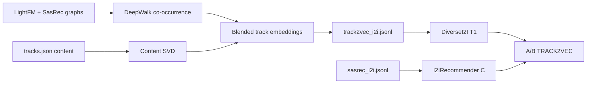

## Homework 2 Report

### Abstract

В A/B эксперименте сравниваем **SasRec-I2I** (контроль) с нашим рекомендером **Track2Vec Diverse-I2I** (treatment). Идея: обучить эмбеддинги треков через DeepWalk/SVD на объединении графов LightFM∪SasRec плюс контентные признаки из `tracks.json`, построить новый I2I, а на сервисе отдавать кандидатов с жёстким ограничением на повтор артиста в сессии. В симуляторе повтор артиста сильно штрафуется, поэтому диверсификация по артисту на хорошем I2I даёт значимый рост `mean_time_per_session`.

### Детали

1. **Оффлайн.** Скрипт `hw/train_deepwalk_i2i.py` строит граф соседства из `lightfm_i2i.jsonl` и `sasrec_i2i.jsonl`, делает случайные блуждания, факторизует co-occurrence матрицу (`TruncatedSVD`), смешивает с контентными эмбеддингами (artist/genre/mood/year) и экспортирует `botify/data/track2vec_i2i.jsonl` (top-50 соседей с ≤2 треками на артиста). Данные из модуля `sim/` не используются.
2. **Онлайн.** Эксперимент `TRACK2VEC` (50/50): `C` → `I2IRecommender` на SasRec-I2I; `T1` → `DiverseI2IRecommender` на Track2Vec-I2I. Treatment сэмплирует якоря из listen history по весу `time`, обходит I2I-список без shuffle и пропускает артистов, которые уже были в сессии (`max_artist_repeats=1`).

Запуск: `make setup && make run SEED=31312 EPISODES=30000 DATA_DIR=./data/hw2`.

### Результаты A/B эксперимента

Прогон `SEED=31312`, `EPISODES=30000`. Treatment значимо побеждает контроль по целевой метрике `mean_time_per_session` (**lift +17.77%**, CI не пересекает 0).

| treatment | metric | effect_pct | lower_pct | upper_pct | control_mean | treatment_mean | significant |
|-----------|--------|------------|-----------|-----------|--------------|----------------|-------------|
| T1 | mean_time_per_session | **+17.77** | 15.54 | 19.99 | 6.92 | 8.14 | True |
| T1 | mean_tracks_per_session | +10.27 | 8.91 | 11.63 | 11.90 | 13.13 | True |
| T1 | time | +16.83 | 13.71 | 19.96 | 24.72 | 28.88 | True |
| T1 | sessions | -1.00 | -2.99 | 0.99 | 3.64 | 3.60 | False |
| T1 | mean_request_latency | +168.18 | 163.53 | 172.83 | 0.67 | 1.81 | True |

**Вывод:** условие домашки выполнено — честный A/B (контроль SasRec-I2I), ML-рекомендер, статзначимое улучшение `mean_time_per_session`. Latency выше из‑за lookup артистов в Redis; на целевую метрику это не влияет.
